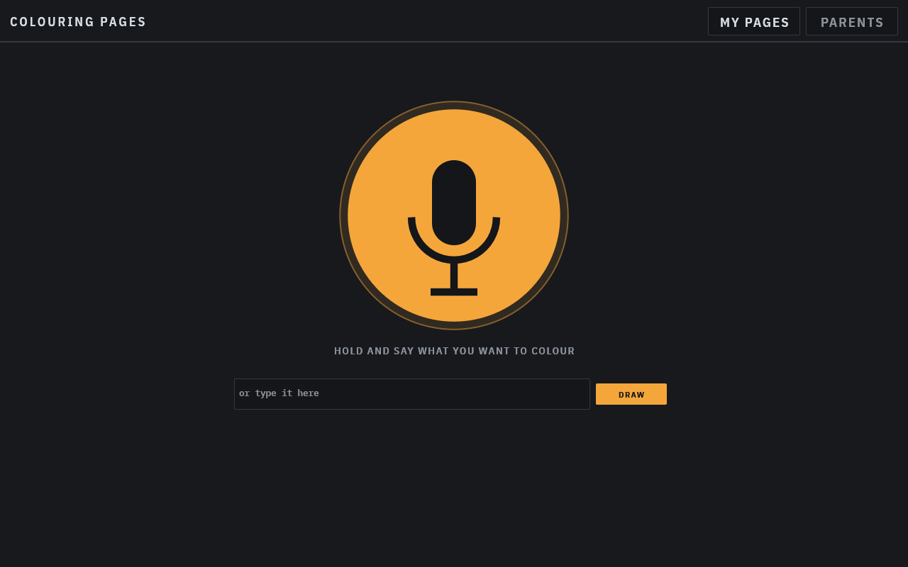
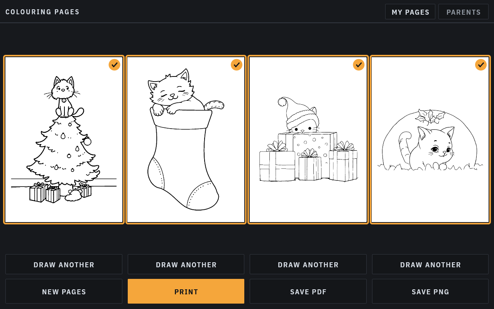
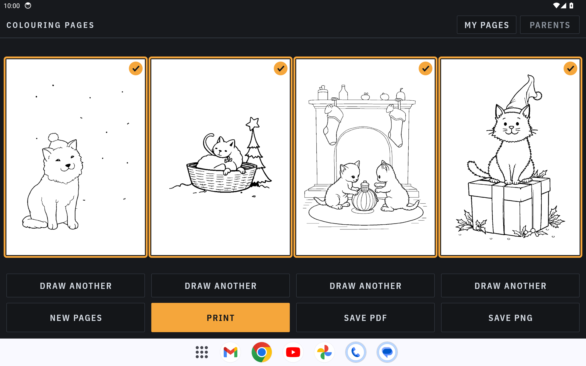

# Colouring Pages

Say what you want to colour in ("cute christmas cats") and get four printable colouring pages.




## How it works

1. Hold the big microphone and speak, or type the request.
2. A language model turns it into a plan: subject, setting, mood, four one-scene page ideas and an age band. Anything not kid-safe is softened or refused.
3. A second call turns each idea into an image prompt. A fixed colouring-page style is always appended (`style::STYLE_SUFFIX`), and a negative prompt is sent where the backend takes one.
4. Four pages are drawn by the backend chosen in settings.
5. Each picture is thresholded to pure black and white, specks are removed, empty results are redrawn, and the art is cropped and fitted to A4 or Letter at 200 dpi.
6. Tap pages to pick them, then print, save a PDF or save PNGs. "Draw another" redraws one page. Every set is kept under "my pages".

Settings sit behind the "parents" key, which opens after a 1.5 second hold.

## Backends

| backend | needs |
|---|---|
| ComfyUI with FLUX.1-dev | a ComfyUI at the address in settings (the workflow is the one in `kids-free-games/art/gen/flux.py`) |
| OpenRouter image models | an API key in settings |

The language model is any OpenAI-compatible chat endpoint (default `https://yalr.v0l.io/v1`, model `code`).

## Reused from other projects

Nothing was added to agentbench or the bench-suite catalog.

- Voice capture: `src/voice/mic.rs` is a trimmed copy of `agentbench/crates/app/src/voice/native.rs` (cpal microphone, take handling, local Whisper through `egui_bench::speech`, or an OpenAI-compatible `/audio/transcriptions` server through `egui_bench::voice::Server`). The endpoint detection and live partial readings were dropped, because the button is hold-to-talk.
- Android microphone permission and activity access: `src/platform.rs` is adapted from `agentbench/crates/app/src/voice/android.rs`. Keyboard and system bar insets in `src/system.rs` are copied from `agentbench/crates/app/src/system.rs`.
- The OpenAI-compatible chat client (`src/llm.rs`) follows the request shape of `agentbench/crates/server/src/titles.rs`, written fresh without the agentbench server types.
- The look: `egui_bench` 0.9.4 (a crates.io dependency) for the theme, keys, sections, modals and toast. The shell layout follows agentbench's app.
- Android packaging: `packaging/android/build.sh` follows agentbench's script (cargo-apk for the library, then a Kotlin activity, aapt2 and apksigner on top).

## Build and run

```
cargo run --release
cargo test
```

Local Whisper is on by default and fetches its model on first use (it reuses `~/.local/share/agentbench/models` when that holds the default model). Without it, set a speech server in settings.

Settings and history live in `~/.local/share/colouring-pages` (override with `COLOURING_PAGES_HOME`). Saved PDFs and PNGs go to `~/Pictures/colouring-pages`. Printing uses `lp`.

### Real services

One run against live ComfyUI and YALR (the key is read from `settings.json`):

```
ssh -f -N -L 18188:127.0.0.1:8188 spark
cargo test --test real_run -- --ignored --nocapture
```

### Android

```
ABI=x86_64 ./packaging/android/build.sh
```

`ABI=arm64-v8a` (the default) builds for a tablet. The APK is `target/android/colouring-pages.apk`. Printing opens the Android print framework with the chosen pages as a PDF. Saving writes into `Downloads/colouring-pages`. The emulator needs `-gpu host`.



### Testing speech without a microphone

If `fake-mic.wav` exists in the data folder, the microphone key plays that clip as the take instead of opening a device, through the same path (judge, resample, transcribe). `COLOURING_AUTOHOLD=3` holds the key for 3 seconds at start, and `./shots_mic.sh DATA_DIR` runs that in headless sway. On the emulator, push the clip into the app's `files/` folder and hold the key with `adb shell input swipe X Y X Y 3000`.

### Screenshots

`./shots.sh NAME WIDTH HEIGHT [ENV=VAL ...]` runs the desktop build inside a private headless sway with the lavapipe software renderer and writes `shots/NAME.png`. `COLOURING_SHOW=settings|gallery|results` opens that screen, and `COLOURING_AUTORUN="a request"` starts a run.
